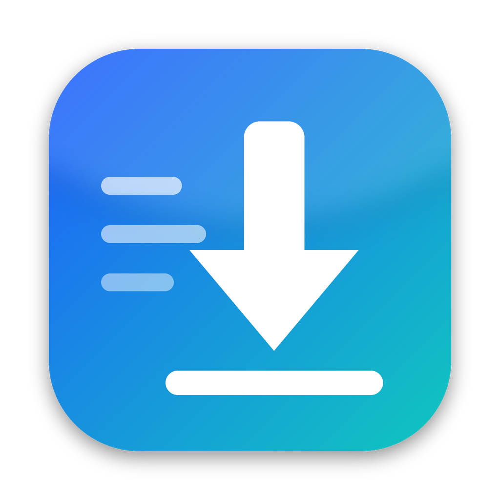

<p align="center">
  
</p>

<h1 align="center">MacOS Download Manager</h1>
<p align="center"><b>Trình tăng tốc tải xuống đa luồng cho macOS — lấy cảm hứng từ Internet Download Manager (IDM)</b><br>
Native Swift / SwiftUI · Apple Silicon & Intel · macOS 13 Ventura trở lên</p>

<p align="center">
  <a href="https://github.com/xuanthanhtnt/MacOS-Download-Manager/releases/latest"><b>⬇️ Tải bản mới nhất (.dmg)</b></a>
</p>

> MacOS Download Manager là dự án độc lập, không liên quan tới Tonec Inc. “Internet Download Manager” và “IDM” là thương hiệu của chủ sở hữu tương ứng.

---

## Tính năng

| Tính năng của IDM | MacOS Download Manager |
|---|---|
| Tăng tốc tải nhờ chia tệp thành nhiều phần, mỗi phần một kết nối riêng | ✅ Tối đa 32 kết nối/tệp, **chia đoạn động** (kết nối xong phần mình sẽ “chia đôi” phần lớn nhất còn lại), tự giảm số kết nối khi máy chủ giới hạn |
| Tạm dừng / tải tiếp (resume), kể cả sau khi tắt máy hoặc mất mạng | ✅ Lưu tiến độ từng phần, tự thử lại khi lỗi mạng |
| Làm mới địa chỉ tải khi link hết hạn (Refresh download address) | ✅ Giữ phần đã tải, chỉ đổi link |
| Bắt link tải từ trình duyệt | ✅ Tiện ích cho Chrome, Edge, Brave, Opera, Vivaldi, Arc, Firefox |
| Menu chuột phải “Download with IDM” / “Download all links” | ✅ |
| Bắt video trên trang web (Video grabber) | ✅ Phát hiện video/âm thanh & luồng **HLS (m3u8)**, tải song song, giải mã AES-128, ghép thành .ts/.mp4 |
| Hộp thoại “Download File Info” (chọn tên, thư mục, thể loại, mô tả) | ✅ Có xem trước dung lượng, khả năng tải tiếp, chọn chất lượng HLS |
| Cửa sổ tiến trình với biểu đồ các kết nối | ✅ Thanh phân đoạn + bảng từng kết nối |
| Hộp thoại “Download complete” | ✅ Mở tệp / mở thư mục |
| Thể loại (Compressed, Documents, Music, Programs, Video) tự xếp tệp vào thư mục | ✅ Thêm/sửa thể loại, đuôi tệp, thư mục |
| Hàng đợi & lịch hẹn giờ (Scheduler) | ✅ Nhiều hàng đợi, số tệp tải cùng lúc, giờ bắt đầu/dừng theo ngày trong tuần, sau khi xong: thoát / ngủ / tắt máy |
| Giới hạn tốc độ (Speed limiter) | ✅ Áp dụng cho toàn bộ lượt tải |
| Theo dõi clipboard | ✅ |
| Ô thả liên kết nổi (Drop target) & kéo-thả vào cửa sổ | ✅ |
| Tải hàng loạt theo mẫu (Batch download `file*.jpg`) | ✅ Số (có độ dài cố định) hoặc chữ cái |
| Quét trang web (Site grabber) | ✅ Duyệt theo độ sâu, lọc theo loại tệp |
| Xuất / nhập danh sách tải (.ef2 của IDM, .txt) | ✅ |
| Đăng nhập trang web (Site logins), proxy HTTP/SOCKS, User-Agent | ✅ Mật khẩu lưu trong Keychain |
| Chạy trình quét virus sau khi tải | ✅ Chạy lệnh bất kỳ với tệp vừa tải |
| Biểu tượng khay hệ thống | ✅ Biểu tượng trên thanh menu + số lượt tải trên Dock |
| Không cho máy ngủ khi đang tải | ✅ |
| Kiểm tra checksum | ✅ MD5, SHA-1, SHA-256, SHA-512 |
| Giao diện tiếng Việt | ✅ Tiếng Việt / English (Options → General → Language) |

## Cài đặt

1. Tải `MacOS-Download-Manager-x.y.z.dmg` ở trang [Releases](https://github.com/xuanthanhtnt/MacOS-Download-Manager/releases/latest).
2. Mở file .dmg, kéo **MacOS Download Manager** vào **Applications**.
3. Ứng dụng chưa được Apple công chứng (notarize) nên lần đầu macOS sẽ chặn. Mở **Terminal** và chạy:
   ```bash
   xattr -cr "/Applications/MacOS Download Manager.app"
   ```
   hoặc chuột phải vào MacOS Download Manager → **Open** → **Open** (macOS 15+: *System Settings → Privacy & Security → Open Anyway*).

### Cài tiện ích trình duyệt (bắt link tải tự động)

MacOS Download Manager chạy một máy chủ nhỏ chỉ trên `127.0.0.1:9614`; tiện ích gửi link tải tới đó (trang web thường bị từ chối).

- **Chrome / Edge / Brave / Opera / Vivaldi / Arc**: MacOS Download Manager → *Options → Browser → Show Extension Folder in Finder* (hoặc thư mục `Browser Extension (Chrome, Edge, Brave)` trong file .dmg). Mở `chrome://extensions`, bật **Developer mode**, bấm **Load unpacked** và chọn thư mục `chrome`.
- **Firefox**: mở `about:debugging` → *This Firefox* → **Load Temporary Add-on…** → chọn `manifest.json` trong thư mục `firefox` (tiện ích tạm sẽ mất khi khởi động lại Firefox; muốn cài vĩnh viễn cần ký tiện ích qua addons.mozilla.org).
- **Safari**: kéo-thả link vào MacOS Download Manager, sao chép link (MacOS Download Manager theo dõi clipboard) hoặc tạo bookmark với địa chỉ:
  ```
  javascript:location.href='macosdm://add?url='+encodeURIComponent(location.href)
  ```

Tiện ích có: tự bắt các tệp theo đuôi, menu chuột phải *Download with MacOS Download Manager* / *Download all links with MacOS Download Manager*, và nút trên thanh công cụ liệt kê video/âm thanh/HLS đang phát trên trang.

## Tự build từ mã nguồn

Cần macOS 13+ và Xcode 15+ (hoặc Command Line Tools có Swift 5.9+).

```bash
git clone https://github.com/xuanthanhtnt/MacOS-Download-Manager.git
cd MacOS-Download-Manager
swift test                     # chạy unit test
./scripts/build_app.sh         # tạo build/MacOS Download Manager.app và build/MacOS-Download-Manager-1.0.0.dmg (universal)
```

Mỗi lần đẩy code lên `main`, GitHub Actions build file .dmg (tab **Actions → Artifacts**). Đẩy tag `vX.Y.Z` sẽ tạo một bản **Release** kèm file .dmg.

## Cấu trúc mã nguồn

```
Sources/MacOSDownloadManager/
├─ App/          MacOSDownloadManagerApp (menu, URL scheme macosdm://), WindowManager
├─ Core/
│  ├─ DownloadEngine.swift   Engine HTTP đa kết nối, chia đoạn động, resume, retry
│  ├─ HLS.swift              Parser m3u8, tải HLS song song, giải mã AES-128
│  ├─ DownloadManager.swift  Danh sách tải, hàng đợi, lịch, lưu trữ JSON
│  ├─ Integration.swift      Máy chủ cho tiện ích trình duyệt, clipboard, thông báo
│  ├─ Tools.swift            Probe URL, batch, site grabber, checksum, nhập/xuất .ef2
│  ├─ Settings.swift / Models.swift / Utilities.swift
└─ Views/        Giao diện SwiftUI (cửa sổ chính, tiến trình, tùy chọn, lịch…)
BrowserExtension/ Tiện ích Chrome (MV3) & Firefox
scripts/          build_app.sh (app + dmg), make_icons.py, sync_extension.sh, gen_strings.py
```

Dữ liệu được lưu tại `~/Library/Application Support/MacOS Download Manager/`.

## Giới hạn hiện tại

- Luồng HLS phát trực tiếp (live) và nội dung có DRM (Netflix, …) không tải được. Với HLS có âm thanh tách riêng, MacOS Download Manager ưu tiên luồng có sẵn âm thanh.
- Tệp .ts ghép từ HLS mở tốt bằng IINA/VLC; QuickTime có thể không phát được .ts.
- Chưa có tiện ích Safari riêng (dùng bookmarklet hoặc kéo-thả).

---

## English

**MacOS Download Manager** is a native macOS download accelerator inspired by Internet Download Manager: multi-connection downloads with dynamic segmentation, pause/resume, browser integration (Chromium & Firefox extension), video/HLS grabber, queues and scheduler, speed limiter, clipboard monitoring, drop target, batch downloads, site grabber, IDM `.ef2` import/export, site logins, proxy, checksum verification and an English/Vietnamese UI.

Download the `.dmg` from [Releases](https://github.com/xuanthanhtnt/MacOS-Download-Manager/releases/latest), drag MacOS Download Manager to Applications and run `xattr -cr "/Applications/MacOS Download Manager.app"` once (the app is ad-hoc signed, not notarized). Build it yourself with `./scripts/build_app.sh`.

License: MIT.
